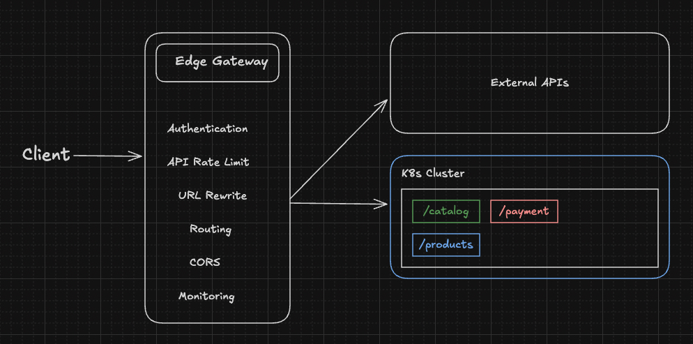

# Edge Gateway

Edge Gateway is an enterprise-grade global API gateway platform built on Kubernetes Gateway API and GitOps principles. It provides centralized traffic management, routing, security, and policy enforcement across multi-region environments. Powered by ArgoCD, Helm, and Gateway API resources, Edge Gateway enables teams to manage APIs consistently at scale with support for rate limiting, authentication, observability, and progressive delivery.

## Infrastructure ownership

- `terraform/gke/` provisions the shared GKE cluster and its Google Cloud networking and node resources.
- `apps/` contains Argo CD Applications and ApplicationSets that deploy in-cluster platform components and workloads.
- `infrastructure/` contains Helm-based configuration for platform components such as Argo CD and Envoy Gateway.

Provision GKE with Terraform before bootstrapping Argo CD. See [the GKE Terraform guide](terraform/gke/README.md) for setup instructions.
